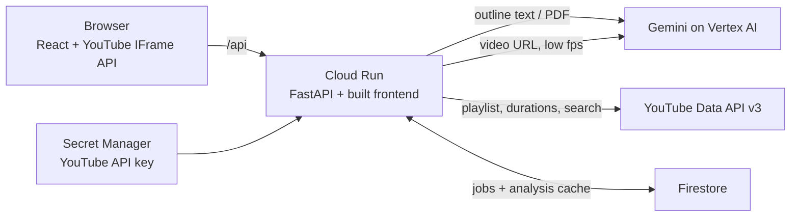

# CourseMap

**Your YouTube playlist, run like a college course.** For the industry skills you learn outside class.

Paste a YouTube playlist and what you want to learn (a topic list, a skill roadmap, a job description or a syllabus PDF). Gemini watches every video and CourseMap turns the playlist into a course:

- **Course map:** every topic in your outline marked Taught, Mentioned or Missing, with timestamps that jump the player to the second it is taught. Missing topics come with videos that cover them.
- **Study plan:** weekly sessions with due dates from your start date and hours per week, a test after each unit, and an "On track / N weeks behind" status.
- **Study notes:** per session, each video's key points with timestamps, copyable as Markdown.
- **Practice:** questions per unit in the test style you pick, tied to the moment the answer is taught. Typed answers are graded, with "rewatch where this is taught".
- **Missing videos replaced:** private, deleted or unwatchable videos are skipped and a replacement on the same subject takes their place.

Built by team **v3as** for the GeeksforGeeks x Google Cloud Hack Sprint.

## How it works



1. **Read the outline.** Gemini turns the pasted text or PDF into units and topics.
2. **Fetch the playlist.** The YouTube Data API lists the videos, durations and privacy. Private, deleted and live videos are set aside.
3. **Watch each video.** Gemini watches the YouTube URL directly (4 at a time, low media resolution) and returns, per topic, where it starts, whether it is explained or only mentioned, and the key points.
4. **Build the course.** Coverage, gap searches, replacement searches and practice questions per unit.
5. **Grade answers** on demand against the expected points.

Guardrails against model mistakes: topic IDs must come from the outline, timestamps are checked against the real video length, questions can only cite moments we extracted, and one failed video never fails the job. Results are cached per video and outline, so a class sharing a playlist pays once.

## Google Cloud

| Service | What it does here |
|---|---|
| Gemini on Vertex AI | Reads the outline, watches each YouTube video by URL, writes questions, grades answers (structured JSON). |
| YouTube Data API v3 | Playlist contents, durations, privacy; videos for gaps and replacements for missing videos. |
| YouTube IFrame Player API | Seeking, playback position for the chapter bar, marking videos watched when they end. |
| Cloud Run | Serves the API and the frontend from one container. |
| Firestore | Job state and the analysis cache. |
| Secret Manager | The YouTube API key. |
| Cloud Build / Artifact Registry | Builds the container on deploy. |

## Repository

```
backend/    FastAPI app (Python 3.13, uv). coursemap/ has the pipeline, Gemini calls, YouTube client, store.
frontend/   React 19 + TypeScript + Vite. The watch page, course map, plan, notes, practice.
deck/       Pitch deck (src.html → build.py → index.html).
docs/       Design spec and implementation plan.
Dockerfile  Builds the frontend, then the Python image that serves both.
```

## Run it locally

Requirements: Python 3.13 with [uv](https://docs.astral.sh/uv/), Node 22+.

**Demo mode (no Google account needed).** Replays a recorded run on a real playlist: Code Step By Step's "Docker tutorial in Hindi" (18 videos) against a 21-topic Docker outline. Paste any playlist link.

```bash
cd frontend && npm ci && npm run build && cd ..
cd backend && DEMO=1 STATIC_DIR=../frontend/dist uv run uvicorn coursemap.main:app --port 8000
# open http://localhost:8000
```

**One-command demo on Windows (no uv needed).** With git and Python 3.11+ installed, download `run_windows.py` into any folder and run `python run_windows.py`. It clones the repo into `.\coursemap`, installs Node.js with winget if it is missing, builds the frontend, creates a venv from `backend/requirements.txt` and starts demo mode at http://localhost:8765. Run it again to update and restart. It also works on macOS and Linux.

**With Gemini and YouTube.** Copy `backend/.env.example` to `backend/.env` and fill in `GOOGLE_CLOUD_PROJECT` and `YOUTUBE_API_KEY` (or set `GOOGLE_GENAI_USE_VERTEXAI=false` and `GEMINI_API_KEY` to use AI Studio instead of Vertex AI). Log in with `gcloud auth application-default login`.

```bash
cd backend && uv run --env-file .env uvicorn coursemap.main:app --port 8000
cd frontend && npm run dev          # http://localhost:5173, proxies /api to :8000
```

Check that Gemini can watch YouTube from your project:

```bash
cd backend && uv run --env-file .env python scripts/smoke_gemini.py <youtube_video_id>
```

**Tests.**

```bash
cd backend && uv run pytest -q      # pipeline, guardrails, API, demo flow
node --test frontend/tests/         # study plan and playback logic
```

## Settings

| Variable | Default | Meaning |
|---|---|---|
| `GEMINI_MODEL` | `gemini-2.5-flash` | Model used for every call. |
| `GOOGLE_GENAI_USE_VERTEXAI` | `true` | Vertex AI (`true`) or AI Studio with `GEMINI_API_KEY` (`false`). |
| `GOOGLE_CLOUD_PROJECT`, `GOOGLE_CLOUD_LOCATION` | none, `us-central1` | Vertex AI project and region. |
| `YOUTUBE_API_KEY` | none | YouTube Data API key. |
| `STORE` | `memory` | `memory` or `firestore`. |
| `MAX_VIDEOS` | `20` | Videos read per playlist. |
| `VIDEO_FPS` | `0.2` | Frames per second Gemini samples; `0` leaves it to the model. |
| `DEMO` | off | `1` replays the recorded course with no Google calls. |

## Deploy to Cloud Run

```bash
export PROJECT_ID=<your-project> SA=coursemap-run@<your-project>.iam.gserviceaccount.com
gcloud services enable run.googleapis.com aiplatform.googleapis.com firestore.googleapis.com \
  youtube.googleapis.com cloudbuild.googleapis.com secretmanager.googleapis.com artifactregistry.googleapis.com
gcloud firestore databases create --location=asia-south1
gcloud iam service-accounts create coursemap-run
for role in roles/aiplatform.user roles/datastore.user roles/secretmanager.secretAccessor; do
  gcloud projects add-iam-policy-binding $PROJECT_ID --member=serviceAccount:$SA --role=$role --condition=None
done
printf "%s" "<youtube-api-key>" | gcloud secrets create youtube-api-key --data-file=-

gcloud run deploy coursemap --source . --region asia-south1 --service-account $SA \
  --allow-unauthenticated --min-instances 1 --max-instances 1 --no-cpu-throttling \
  --memory 1Gi --timeout 3600 \
  --set-env-vars GOOGLE_CLOUD_PROJECT=$PROJECT_ID,GOOGLE_CLOUD_LOCATION=us-central1,GOOGLE_GENAI_USE_VERTEXAI=true,STORE=firestore,MAX_VIDEOS=20 \
  --set-secrets YOUTUBE_API_KEY=youtube-api-key:latest
```

One instance keeps background jobs and polling together; Firestore keeps state across restarts.
